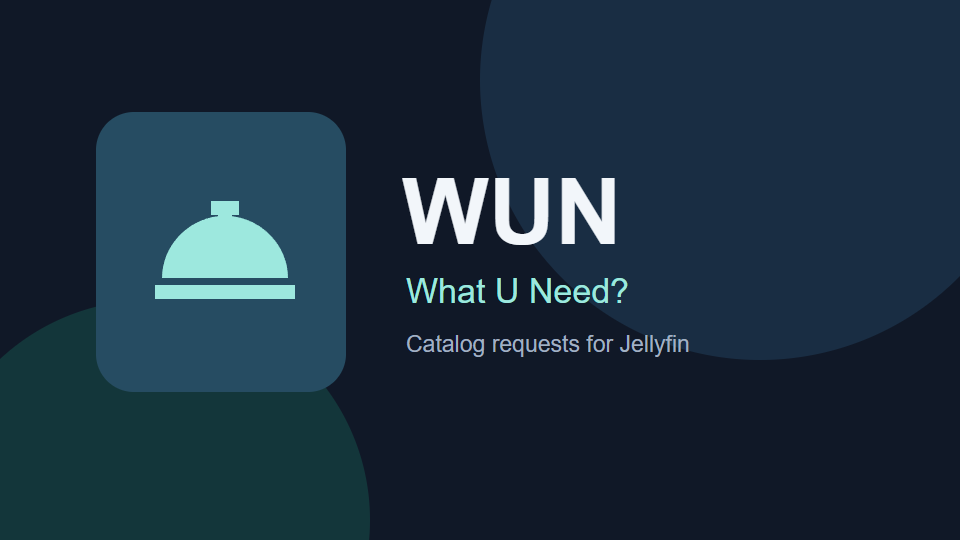

# Betterfin

A public plugin catalog with a separate manifest for each Jellyfin major version.
It is an independent community repository, not an official Jellyfin catalog.

## Add the catalog

In **Dashboard → Plugins → Repositories**, add:

| Jellyfin family | Manifest | Current compatibility |
| --- | --- | --- |
| 12 | `https://raw.githubusercontent.com/guiguichinelo/betterfin/main/12/manifest.json` | PLM + WUN betas: tested on 12.4.0, Linux x64 |

The manifest family is not a guarantee that every minor version or architecture
is supported. Jellyfin's targetAbi is a minimum version; read each plugin's
release notes. This first catalog deliberately includes a prerelease.

## Plugins

### Personal Library Manager — beta 2


Private lists, native favorites, Watch Later, thumbnails and browse filters.

- [Source](https://github.com/guiguichinelo/plm_plugin)
- [Beta release](https://github.com/guiguichinelo/plm_plugin/releases/tag/v0.1.0-beta.2)
- Release tag `v0.1.0-beta.2`; Jellyfin catalog/assembly version `0.1.0.2`.
- **Linux x64 / Jellyfin 12.4.0 only in this beta.** The catalog does not select
  downloads by operating system or CPU; do not install this archive on Windows or ARM.
- The web interface requires Plugin Pages and File Transformation **3.0.3.0,
  Release-12.4.0 builds**. Install those from their maintainers' repositories first.
- Back up Jellyfin and PLM data before installing. Native-client playback,
  sustained load and other server versions remain unvalidated.

### What U Need? - beta 4

Personal catalog requests, unique supports, administrator decisions and rich notifications. Native configuration/metrics, availability updates and optional retention. All deletion and expiration policies default to disabled. Database schema 3 requires a matching data/binary backup for rollback.

- [Source](https://github.com/guiguichinelo/wun_plugin)
- [Beta release](https://github.com/guiguichinelo/wun_plugin/releases/tag/v0.1.0-beta.4)
- Jellyfin catalog/assembly version `0.1.0.4`; Linux x64 / Jellyfin 12.4.0.
- Acquisition is manual. User-facing pages require Plugin Pages and File Transformation 3.0.3.0 Release-12.4.0. Review the release notes before installing.

## Maintain versioned catalogs

`plugins/<slug>.json` defines the plugin. Immutable build
receipts live in `releases/<slug>/`; each contains numeric version, target ABI,
asset URL, source commit, timestamp, MD5 and SHA256. Artifacts themselves are
attached to the plugin's GitHub release, not copied into this repository.

```sh
python scripts/build-manifests.py
python scripts/build-manifests.py --check
```

Add a receipt only after checking the release bytes. Never replace an already
published version with a different ZIP/checksum; publish a new version instead.
The generator validates GUIDs, numeric versions, ABI family, hashes and public
HTTPS links, routing each release to the major in its targetAbi. CI checks that
committed manifests match reviewed inputs. A new Jellyfin family gets a separate
directory when its first matching release receipt is added.

Jellyfin requires MD5 in `checksum`; SHA256 is retained in each receipt and in the
release's SHA256SUMS.txt. [Manifest format](https://jellyfin.org/posts/plugin-updates/).

## Artwork

The [thumbnail](assets/plm/thumbnail.png) is original AI-generated artwork made
with the built-in image_gen tool. Its [prompt](assets/plm/thumbnail.prompt.md) is
included for reproducibility. No private server screenshots or branding are used.

GPL-3.0; see [LICENSE](LICENSE). Plugin binaries retain their own licenses and notices.

## What U Need? — beta 2



Catalog requests with movie/series details, seasons, episode images and availability. Native likes remain independent from PLM saved-list indicators.

- [Source](https://github.com/guiguichinelo/wun_plugin)
- [Beta release](https://github.com/guiguichinelo/wun_plugin/releases/tag/v0.1.0-beta.2)
- Release 0.1.0-beta.2, numeric catalog/assembly version 0.1.0.2.
- Jellyfin 12.4.0 / Linux x64; requires the same Plugin Pages/File Transformation dependencies listed above.
- Acquisition is manual. Automatic monitoring workers and review reminders are pending.
- The WUN thumbnail is original SVG artwork rendered as PNG; it contains no server screenshots or personal branding.
